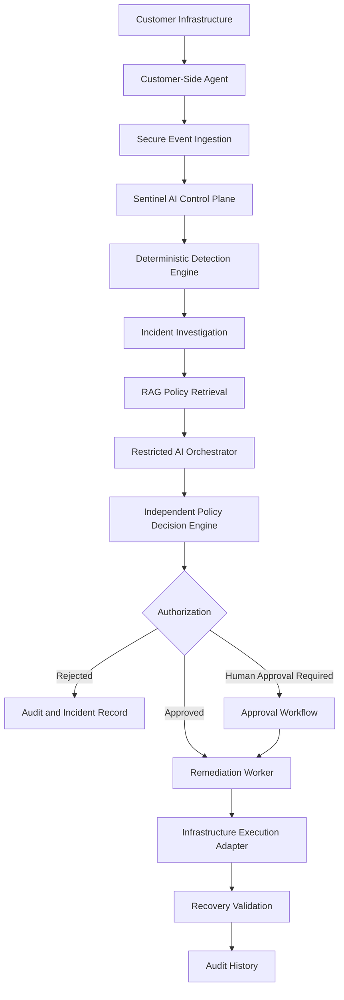

# 🛡️ Sentinel AI
### Security-First | Self-Healing Infrastructure Security Platform

**Detect. Investigate. Authorize. Remediate. Recover.**

Sentinel AI is an AI-assisted infrastructure security platform designed to help organizations monitor, investigate, and respond to infrastructure security incidents across containerized and cloud environments.

The platform aims to combine deterministic configuration drift detection, Retrieval-Augmented Generation (RAG), policy-driven authorization, controlled remediation, and trusted baseline restoration into a unified security-first infrastructure management system.

Unlike unrestricted AI automation systems, Sentinel AI follows a security-first execution model: **AI can recommend actions, but independent policy controls determine whether those actions are authorized.**

---

## 🎯 Vision

Modern infrastructure environments continuously change. Misconfigurations, unauthorized modifications, insecure deployments, and configuration drift can introduce security vulnerabilities.

Sentinel AI aims to address these challenges through:

- Continuous infrastructure monitoring.
- Deterministic configuration drift detection.
- Context-aware security investigation.
- RAG-powered security policy retrieval.
- AI-assisted remediation planning.
- Independent policy authorization.
- Human-approved and controlled autonomous remediation.
- Trusted baseline restoration.
- Mandatory post-remediation validation.
- Tamper-evident audit history.

Our objective is to build infrastructure security that is intelligent, explainable, controlled, and recoverable.

---

## 🏗️ Architecture Overview

Sentinel AI follows a control-plane and execution-plane architecture.

### Core Architectural Components

| Component | Responsibility |
|---|---|
| Control Plane | Central management and orchestration |
| Execution Plane | Customer-side infrastructure operations |
| Secure Event Ingestion | Authenticated infrastructure event collection |
| Detection Engine | Deterministic configuration drift detection |
| RAG Service | Retrieval of relevant security policies |
| AI Orchestrator | Investigation and remediation recommendations |
| Policy Engine | Independent authorization decisions |
| Remediation Worker | Controlled execution of approved operations |
| Execution Adapters | Infrastructure-specific integrations |
| Audit System | Execution evidence and security history |

*The diagram represents the intended architecture, not a claim that every component is already implemented.*

---

## 🔐 Security-First Engineering Principles

Security is a foundational requirement of Sentinel AI.

### 1. Restricted AI Execution

- No unrestricted shell access for AI agents.
- No infrastructure credentials exposed to LLMs.
- AI-generated actions must pass independent authorization.
- Only explicitly permitted operations can be executed.

### 2. Independent Policy Authorization

The AI orchestration layer and policy decision engine must remain separate.

An AI-generated remediation recommendation does not automatically authorize infrastructure changes.

### 3. Controlled Remediation

- Human approval where required.
- Customer-defined approval policies.
- Validated state-changing operations.
- Duplicate job prevention.
- Execution evidence for every remediation.

### 4. Trusted Recovery

- Protected infrastructure baselines.
- Trusted configuration restoration.
- Isolation of failed resources.
- Mandatory recovery validation.
- Fail-safe behavior during control-plane outages.

### 5. Secure Communication

- Authenticated agent communication.
- Encrypted communication channels.
- Tenant-aware authorization.
- Secure secret management.

---

## 🧠 AI and Deterministic Security

Sentinel AI is designed around a hybrid security model.

| Layer | Purpose |
|---|---|
| Deterministic Detection | Identifies actual configuration differences |
| RAG | Retrieves relevant policies and security documentation |
| AI Investigation | Explains incidents and provides context |
| AI Remediation Planning | Suggests possible corrective actions |
| Policy Decision Engine | Independently validates authorization |
| Execution Worker | Performs authorized operations |
| Recovery Validation | Verifies the resulting infrastructure state |

**Core principle:** AI provides intelligence; deterministic controls provide enforcement.

---

## 🛠️ Technology Architecture

The commercial architecture is expected to use the following technologies as appropriate to the existing implementation.

| Layer | Proposed Technology |
|---|---|
| Backend API | Python / FastAPI |
| Data Validation | Pydantic |
| Database | PostgreSQL |
| Database Migrations | Alembic |
| Authentication | OIDC-compatible authentication |
| Authorization | RBAC and policy-based controls |
| Background Jobs | Durable job processing |
| AI Integration | LLM + RAG |
| Monitoring | Prometheus |
| Visualization | Grafana |
| Deployment | Docker |
| Version Control | Git / GitHub |

Technology selection and adoption will be incremental. Existing working MVP components will be preserved wherever practical.

---

## 🚀 Development Status

Sentinel AI is evolving from a challenge prototype toward a commercial infrastructure security platform.

### Development Roadmap

- [x] Challenge prototype development
- [ ] Production architecture assessment
- [ ] Secure multi-tenant backend
- [ ] PostgreSQL persistence
- [ ] Deterministic drift detection hardening
- [ ] Secure customer-side agent communication
- [ ] Tenant-isolated RAG
- [ ] Independent policy authorization
- [ ] Durable remediation execution
- [ ] Human approval workflows
- [ ] Trusted baseline restoration
- [ ] Mandatory recovery validation
- [ ] Tamper-evident audit history
- [ ] Prometheus and Grafana observability
- [ ] Enterprise deployment support

*Checklist items must be updated against the actual repository implementation.*

---

## ☁️ Deployment Strategy

Sentinel AI is designed with three potential deployment models.

**1. Cloud-Hosted SaaS**

A centrally managed platform supporting multiple organizations with strict tenant isolation.

**2. Customer-Hosted Private Deployment**

A deployment operating within a customer's private cloud or infrastructure environment.

**3. Self-Hosted Enterprise**

A fully customer-managed deployment for organizations requiring complete infrastructure and data control.

The initial focus is to establish a secure, maintainable foundation before introducing multiple deployment models.

---

## 💼 Commercial Product Direction

Sentinel AI is intended to evolve into a subscription-based infrastructure security platform.

Potential commercial capabilities include:

- Organization and tenant management.
- Resource-based subscription plans.
- Centralized security dashboards.
- Incident investigation and reporting.
- Audit exports.
- Configurable data retention.
- Enterprise identity integration.
- Customer-specific security policies.
- Enterprise support and deployment options.

---

## 🛡️ Security Disclaimer

Sentinel AI is currently an evolving prototype and development project.

It must not be considered production-ready solely because the application runs successfully in Docker.

No live customer infrastructure should be connected without appropriate security reviews, authorization controls, testing, monitoring, and recovery mechanisms.

The project prioritizes preserving the working MVP while progressively introducing production-grade security and reliability.

---

## 📌 Engineering Philosophy

1. Security before automation.
2. Deterministic detection before AI interpretation.
3. Authorization before execution.
4. Human control over sensitive operations.
5. Recovery validation before declaring success.
6. Auditability throughout the execution lifecycle.
7. Incremental evolution instead of unnecessary architectural complexity.

---

## 👨‍💻 Project

**Sentinel AI — Infrastructure Security & Self-Healing Platform**

Built with a focus on infrastructure security, controlled AI orchestration, policy enforcement, and reliable recovery.

**Status:** Active Development

---

*Building infrastructure that doesn't just detect failures, but responds to them responsibly.*